# FindSurface Isaac Sim Demo — User Manual

> **Scanner > Point Cloud Sensor** offers D455 DepthSensor and Ouster OS0 REV6/REV7
> RTX LiDAR profiles. See [LiDAR sensors](docs/LIDAR_TESTING.md) for selection,
> Gaussian error and coverage details. Sensor-specific Disparity Noise controls
> apply only to DepthSensor; the screenshots below use DepthSensor.

This guide covers the app's controls and workflows. For its purpose and result
interpretation, see the [README](README.md). For DLL setup, see
[native SDK setup](NATIVE_SDK.md).

## Start with a live scan

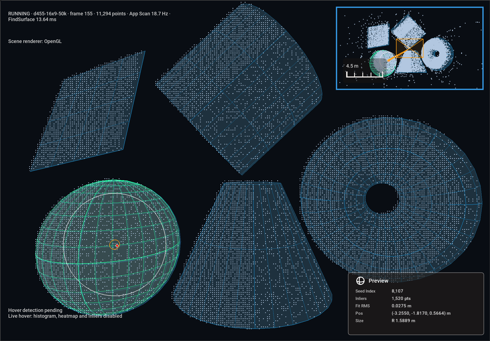

1. Run `Start_Demo.bat` (Windows) or `bash Start_Demo.sh` (Ubuntu x86_64) for dependency setup and launch (see [INSTALL.md](INSTALL.md)). `Launch_Demo.bat` is an alias for the same Windows setup flow. The first Isaac Sim start can take several minutes.
2. The default **Follow live** mode keeps the selected sensor aligned with the scanner camera and updates the cloud continuously. D455 DepthSensor is the packaged default; Scanner also offers Ouster OS0 LiDAR. The scanner view starts as the main view; the scene view is picture-in-picture. Use the view buttons or `P` to swap them.
3. Point at one of the five objects: plane, sphere, cylinder, cone, or torus. In **Auto** mode, hovering over a point requests a FindSurface preview. Buttons `1`–`6` choose Auto and the five specific types. **Inspect** (backtick) pauses detection without deleting captures.
4. A live hover preview shows the detected geometry. Live scans deliberately skip the more expensive inlier heatmap and histogram analysis; freeze the cloud to inspect those results.

The upper-left overlay shows **App Scan Hz** (published clouds per second) and
**FindSurface ms** (the mean successful duration within the last N SDK `find()` calls).
Cloud preparation, result conversion, analysis and idle time are excluded.
Failed calls advance the window but do not enter its sum or denominator. With
no calls the window holds; with no successes in the window it shows `-- ms`.
The default window is 10 calls; configure it in
[Settings > FindSurface Timing](#findsurface-call-time).
A preview is provisional, not a capture. A failed detection does not imply that the sensor failed to produce points: the cursor may miss the probe, there may be too few useful points, or the selected FindSurface type/parameters may not fit the surface.

## Toolbar button reference

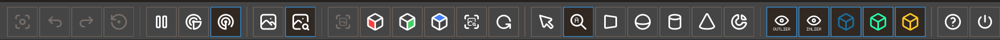

The icons below use manual-only copies of the current toolbar SVGs on dark
rounded tiles so their white glyphs remain legible on light Markdown themes.
The app icons themselves are unchanged. Buttons with a selected state are
highlighted in the app; unavailable buttons keep their border but gray out the
icon. The original, preview and captured mesh icons use their blue, green and
yellow role colors in the manual as well; these fixed toolbar colors do not
follow later Graphics palette edits.

### Capture and history

| Icon | Button | What it does |
|:---:|---|---|
|  | **Capture** (`Ctrl+C`) | Saves the current successful selection in Frozen mode. Disabled until the selected point, scan, and settings match a current result. |
|  | **Undo** (`Ctrl+Z`) | Reverts the latest undoable user command. Continuous sensor frames do not enter history. |
|  | **Redo** (`Ctrl+Shift+Z`) | Reapplies an undone command. |
|  | **Reset captures** (`Ctrl+R`) | Removes the captured geometries for all five types as one undoable action. It does not reset the cameras, objects, or settings. |

### Sensor and view

| Icon | Button | What it does |
|:---:|---|---|
|  | **Frozen** | Keeps the sensor pose and last cloud fixed. Use this mode to select and capture. |
|  | **Fixed live** | Keeps sensor pose fixed while continuing to refresh the cloud. |
|  | **Follow live** | Aligns the sensor with the scanner camera and continuously refreshes the cloud. This is the startup mode. |
|  | **Scene primary** (`P`) | Makes the scene view large and the scanner view picture-in-picture. |
|  | **Scanner primary** (`P`) | Makes the scanner view large and the scene view picture-in-picture. This is the startup layout. |

### Camera

| Icon | Button | What it does |
|:---:|---|---|
|  | **Reset scene camera** (`R` when scene is primary) | Restores the scene camera's startup view. |
|  | **Scene +X** | Red face; positions the scene camera at its +X view preset. |
|  | **Scene +Y** | Green face; positions the scene camera at its +Y view preset. |
|  | **Scene +Z** | Blue face; positions the scene camera at its +Z view preset. |
|  | **Reset scanner camera** (`R` when scanner is primary) | Restores the scanner camera's startup view. |
|  | **Reset scanner up** | Removes scanner camera roll while keeping its viewing direction. |

### Detection mode

These are mutually exclusive. A specific type constrains what FindSurface tries to fit; it does not change the original object or scan.

| Icon | Button | What it does |
|:---:|---|---|
|  | **Inspect** (backtick) | Pauses hover/click detection and clears provisional preview or selection while leaving captures intact. |
|  | **Auto** (`1`) | Lets FindSurface choose among the analytic types. |
|  | **Plane** (`2`) | Requests a plane. |
|  | **Sphere** (`3`) | Requests a sphere. |
|  | **Cylinder** (`4`) | Requests a cylinder. |
|  | **Cone** (`5`) | Requests a cone. |
|  | **Torus** (`6`) | Requests a torus. |

### Global visibility and application

Visibility buttons only change drawing; they do not alter the sensor cloud or detected parameters. The three mesh buttons share the same cube glyph, but the app tints original, preview, and captured roles differently.

| Icon | Button | What it does |
|:---:|---|---|
|  | **Outlier** (`O`) | Shows or hides non-inlier cloud points. |
|  | **Inlier** (`I`) | Shows or hides detected/captured inlier points. |
|  | **Mesh (original)** (`M`) | Shows or hides original designed meshes. |
|  | **Mesh (hover preview)** (`B`) | Shows or hides the provisional detected mesh. |
|  | **Mesh (captured)** | Shows or hides captured meshes as a group. |
|  | **Help** (`Shift+/`) | Opens the in-app controls and shortcut guide. |
|  | **Safe Exit** (`Alt+F4` or `Ctrl+Shift+Q`) | Closes the app through its cleanup path. The normal window-close action uses the same path. |

## Freeze, select, and capture

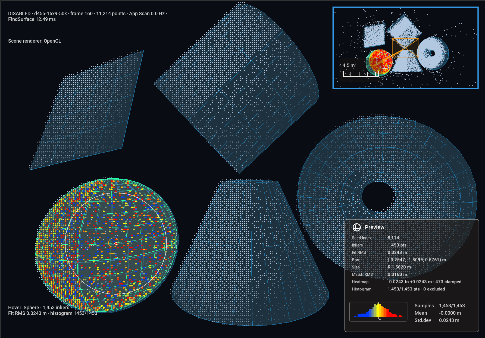

The three sensor modes control pose and scanning independently:

| Mode | Sensor pose | Point cloud |
|---|---|---|
| **Frozen** | Fixed | Last completed scan retained; no continuous updates |
| **Fixed live** | Fixed | Continuously updated |
| **Follow live** | Matches the scanner camera | Continuously updated |

Choose **Frozen** before capturing. Hover over the desired point; move slowly enough to allow a preview to complete. Left-click selects a point, and `Esc` clears the selection. Selection and cone sweeping work in either view when that view is the main viewport. If a point was selected in the other view, clear it first with `Esc` or an empty-space click. The circular probe is sized at the selected point's depth, so it represents a perspective-correct screen-space search region.

With a frozen cloud and a current successful result for the selected point and settings, press **Capture** or `Ctrl+C`. Capture never freezes the sensor automatically. Each geometry type has one capture slot; capturing the same type again replaces the earlier capture and returns its former inliers to the outlier cloud. **Reset captures** (`Ctrl+R`) removes captures only, not camera, object, or settings changes. Undo/Redo can reverse supported user commands.

`Alt`/`Option` while hovering holds the last successful seed index. `Alt`/`Option` + left-click can select the most recently successful detection when the current point has no successful result; a fleeting Sticky preview is not itself a current capture result. **Sticky Auto Preview** in Settings keeps a successful preview visible briefly after later failed attempts. It does not make an expired or mismatched result eligible for Capture.

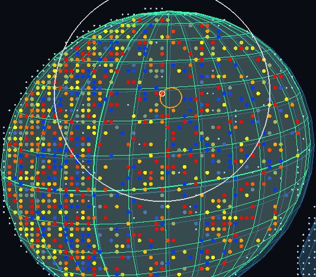

The large white circle represents Seed Radius at the seed's depth. The small
probe and seed marker identify the screen-space picking region and picked point.

## Read a result

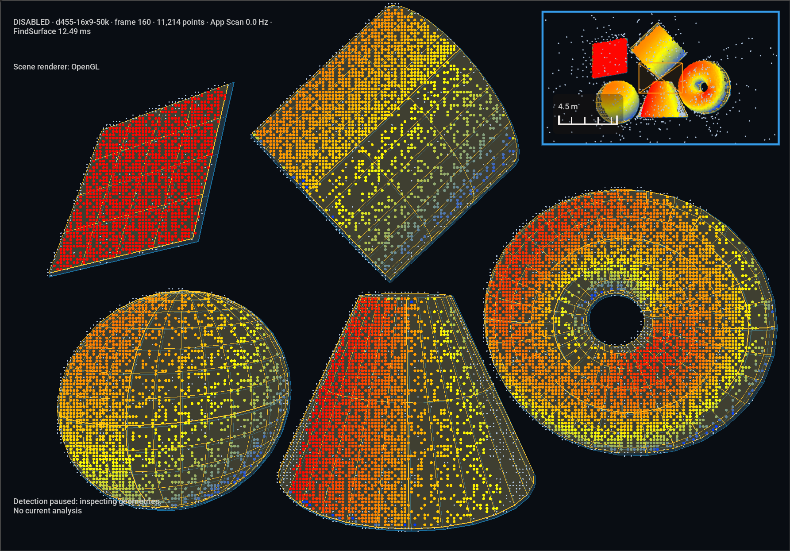

| Live preview | Frozen preview with analysis |
|:---:|:---:|
| 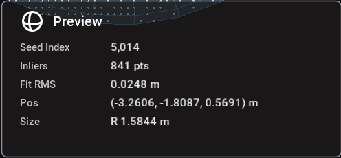 | 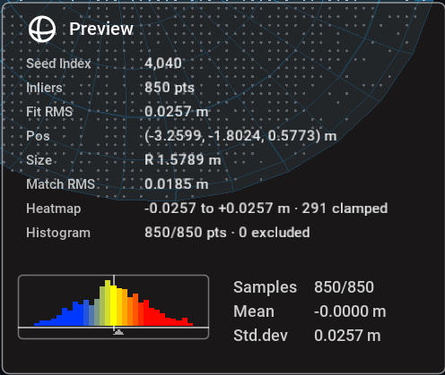 |

The lower-right overlay summarizes the current preview. In Frozen mode, it reserves the histogram area while analysis is pending, then fills it when ready. In live modes, that histogram area is omitted and the overlay is compact.

The lower-left Frozen hover/selection summary labels the detection's **Fit RMS** explicitly. This is the inliers' fitting error, not the surface-to-surface Match RMS; it is available before histogram analysis finishes.

The **Geometries** window contains one collapsible card per captured type. A card shows the detected geometry alongside the original object as it was at capture time. Its **Difference** column uses detected minus original for signed lengths, distance for position, and the appropriate axis/normal angle for orientation. Editing Objects later does not change that captured ground truth. Three histograms describe signed residuals relative to the detected surface, the original surface, and the distance between their corresponding surface-side foot points. Their statistics and sample counts appear next to each chart. Hover over a bar to see its sample count and percentage; hover over a histogram to preview its associated heatmap without changing the card's selected heatmap radio button.

The toolbar visibility controls separately toggle outliers, inliers, original meshes, preview meshes, and captured meshes. See [Geometries](#geometries) for the captured cards' individual visibility and deletion controls.

## Property windows

These tables use the labels visible in the current app. A changed numeric value generally takes effect without an Apply button; the Point Cloud Sensor profile is the deliberate exception. **Reset to Startup** in a property window restores that window's controls to their launch-time state. It is different from toolbar **Reset captures** and Settings **Restore Settings Defaults**.

### FindSurface

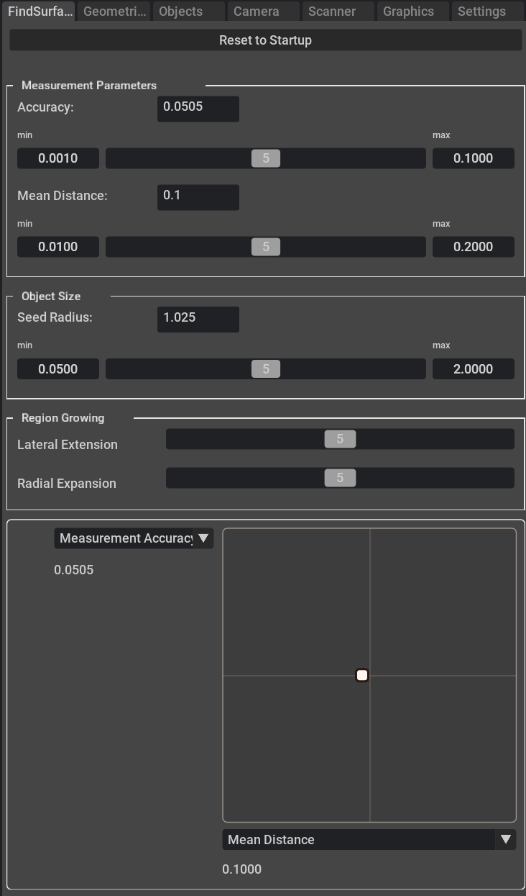

The three floating-point rows each contain a current value, editable minimum/maximum, and a slider. Their units are metres. Editing a row updates the 2D pad when that parameter is assigned to an axis, and dragging the pad updates the row.

| UI element | Meaning |
|---|---|
| **Reset to Startup** | Restores the FindSurface parameter state from when this app session started. |
| **Measurement Parameters > Accuracy** | Expected measurement error of the cloud, used to judge whether points fit a candidate surface. It is not a sensor-noise switch. |
| **Measurement Parameters > Mean Distance** | Expected typical spacing between neighboring cloud points. |
| **Object Size > Seed Radius** | World-space radius around the picked seed used to start detection; the viewport's guide circle is perspective-scaled at the seed depth. |
| **Region Growing > Lateral Extension** | Controls how strongly the fitted region extends along the candidate surface. |
| **Region Growing > Radial Expansion** | Controls outward expansion of the growing region from its seed. |
| **2D pad > X/Y parameter menus** | Assign different parameters to the horizontal and vertical axes; the two axes cannot select the same parameter. |
| **2D pad > knob** | Drag to change both assigned parameters together. The value labels beside the menus show their current values. |

The toolbar's Auto/Plane/Sphere/Cylinder/Cone/Torus buttons select the detection type; they are not duplicated in this window. FindSurface parameter changes affect later detection requests, not the sensor's point positions.

### Geometries

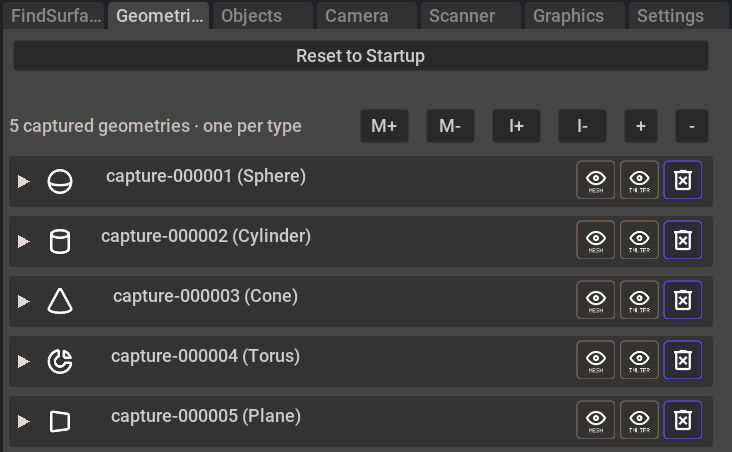

This window has at most one captured result per type. The upper controls operate on all captures; the icon buttons in each card header operate only on that card.

| UI element | Meaning |
|---|---|
| **Reset to Startup** | Restores this window's startup state; use toolbar Reset captures to explicitly clear all captured results. |
| **Captured count** | Shows how many captured cards exist. An empty window explains the Frozen → select → Capture sequence. |
| **M+ / M-** | Shows or hides every captured mesh through the per-card visibility states. |
| **I+ / I-** | Shows or hides every capture's inlier points through the per-card visibility states. |
| **+ / -** | Expands or collapses all captured cards. Clicking a card's own header toggles only that card. |
| **Card header** | Shows capture ID/type and a shape icon. Hovering highlights this card's mesh/inliers relative to other captures. |

The card header toggles its details. Its separate mesh and inlier buttons control visibility, and the red delete button removes that capture. Hovering over a card highlights its captured mesh and inliers relative to other captures.

Each card header starts with a small icon for its geometry type (the same plane/sphere/cylinder/cone/torus icons shown in the detection table). These are the action icons on the right side of a card, visible in the image above; clicking one does **not** collapse the card:

| Icon | Card button | What it does |
|:---:|---|---|
|   | **Mesh on/off** | Shows or hides only this captured mesh; the glyph changes with its state. |
|   | **Inliers on/off** | Shows or hides only this capture's inlier points; the glyph changes with its state. |
|  | **Delete** | Deletes this captured result. Its previous inliers return to the outlier cloud until another capture claims them. |

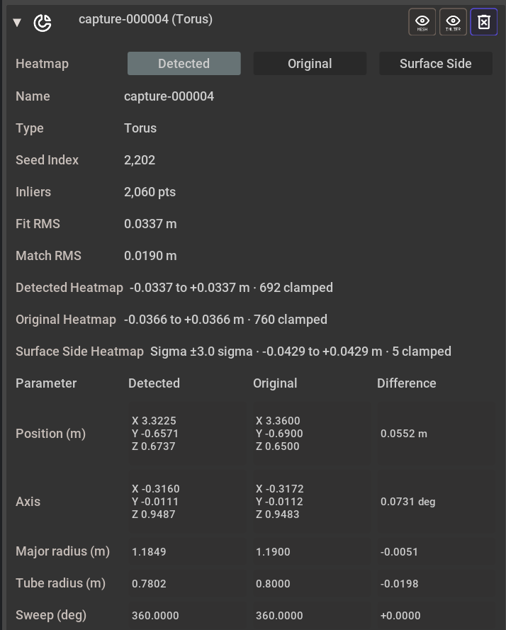

| UI element | Meaning |
|---|---|
| **Heatmap > Detected / Original / Surface Side** | Chooses the signed inlier-color basis for this capture: point-to-detected surface, point-to-original surface, or separation between the two surfaces. |
| **Result fields** | Show the capture's seed, fit/error, inlier count, and type-specific geometry values. |
| **Parameter / Detected / Original / Difference** | Compares the fitted geometry with the original object's state *at capture time*. Signed lengths use detected minus original; position uses distance; axis/normal uses angular separation. |

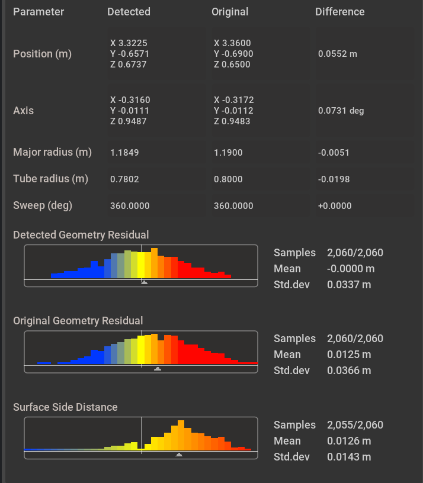

| UI element | Meaning |
|---|---|
| **Detected Geometry Residual** | Histogram of inlier distances relative to the detected surface. |
| **Original Geometry Residual** | Histogram of the same inliers relative to the captured original surface. |
| **Surface Side Distance** | Histogram of distances between the corresponding foot points on the detected and original surfaces, with inside/outside sign. |
| **Histogram bars and statistics** | Hover a bar for its count and percentage. The chart's side columns show sample use, mean, and standard deviation. Hovering a whole histogram temporarily previews its heatmap without changing the selected radio button. |

### Objects

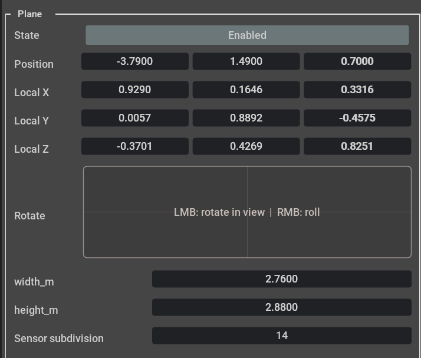

Each of the five object groups has the same basic controls plus type-specific dimensions. Changes to sensor geometry trigger an updated scan; while a scan is pending, the displayed mesh can change before the cloud does.

| UI element | Meaning |
|---|---|
| **Reset to Startup** | Restores object controls to their state when the app launched. |
| **Plane / Sphere / Cylinder / Cone / Torus** | Separate groups for the five original designed objects. |
| **State > Enabled / Disabled** | Toggles the object's participation and visibility; the button text reports its current state. |
| **Position** | Edits the object's world position in metres using X/Y/Z values. |
| **Local X / Local Y / Local Z** | Shows and edits the local basis-axis directions in world coordinates. Edited directions are validated/normalized when the edit ends. |
| **Rotate pad** | Left-drag rotates relative to the current primary view. Right-drag rolls the object around the viewing direction according to the cursor's angle around the pad centre. |
| **Geometry dimensions** | Type-specific metre values such as width, height, radius, length, and torus major/minor radius. The Settings minimum-length rule applies when editing. |
| **Sensor subdivision** | Changes the explicit mesh used by the USD sensor and therefore the shape sampled into the cloud. The visually rendered subdivision is configured separately in Graphics. |

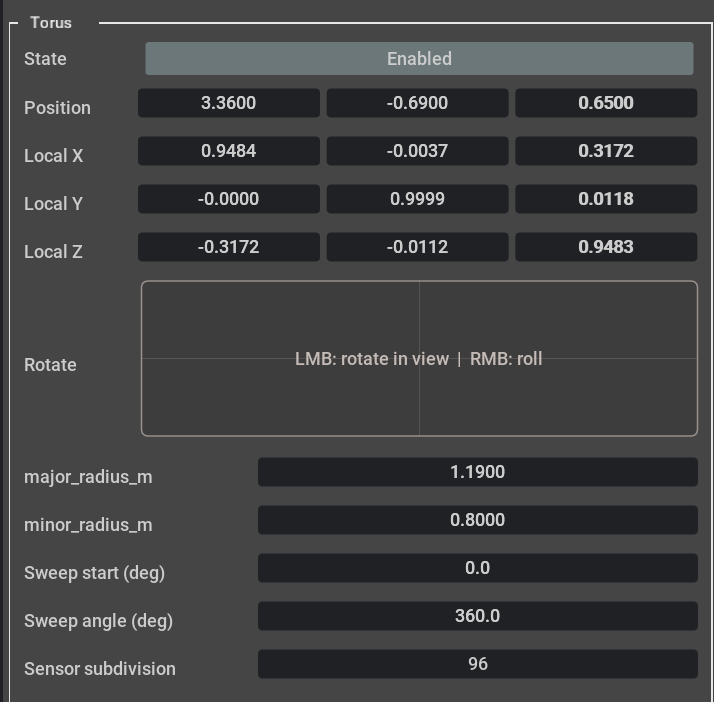

| UI element | Meaning |
|---|---|
| **Sweep start (deg) / Sweep angle (deg)** | Torus-only: starting angle and angular extent. These are angles, not lengths. |

### Camera

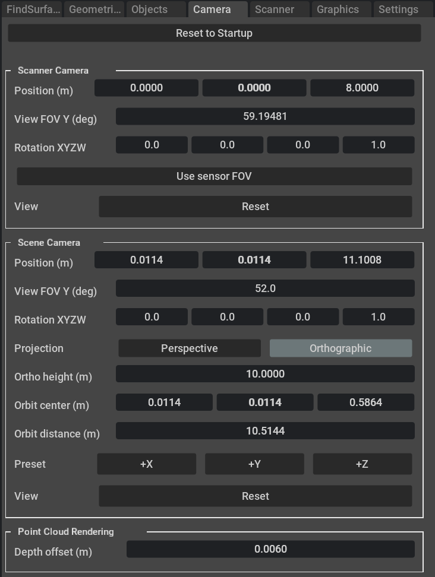

Scanner and Scene Camera are independent groups. The field-of-view values control their viewport projections, not the D455 sensor optics or OS0 angular scan pattern.

| UI element | Meaning |
|---|---|
| **Reset to Startup** | Restores camera controls to the state at app launch. |
| **Scanner/Scene Camera > Position (m)** | Edits the corresponding camera's world X/Y/Z position. |
| **View FOV Y (deg)** | Vertical viewing angle for the viewport camera. For an orthographic scene view, Ortho height controls the visible span instead. |
| **Rotation XYZW** | Camera orientation quaternion in world coordinates; non-zero edits are normalized. |
| **Scanner > Use sensor FOV** | Sets the scanner viewport's FOV to match the currently applied DepthSensor profile. LiDAR has no equivalent camera-image FOV to match. |
| **Scene > Projection** | Switches the scene camera between Perspective and Orthographic. The scanner camera remains Perspective. |
| **Scene > Ortho height (m)** | Vertical world-space span in Orthographic mode. The scene ruler appears only in this mode. |
| **Scene > Orbit center (m)** | Moves the orbit target and scene camera together, preserving their offset. |
| **Scene > Orbit distance (m)** | Sets the camera-to-orbit-center distance. |
| **Scene > Preset +X / +Y / +Z** | Sets an axis-aligned scene view. The toolbar has matching icon buttons. |
| **View > Reset** | Resets only the camera in that group, without restoring other property windows. |
| **Point Cloud Rendering > Depth offset (m)** | Allows a small depth tolerance when rendering a cloud from a pose different from the sensor. It affects point visibility, not measured point coordinates. |

### Scanner

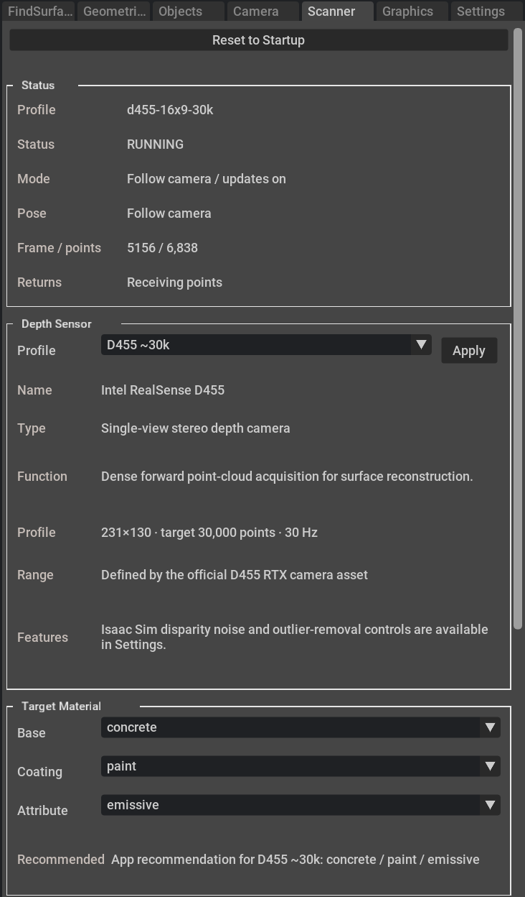

The profile list contains D455 DepthSensor variants and ten Ouster OS0 LiDAR
profiles. OS0 REV6 and REV7 each offer 128 channels with 10 Hz at 512/1024/2048
horizontal samples or 20 Hz at 512/1024 samples. Picking an entry displays its
information; it does not switch the running sensor until **Apply** is pressed.
The screenshots show DepthSensor; the shared selector is now named
**Point Cloud Sensor**.

| UI element | Meaning |
|---|---|
| **Reset to Startup** | Restores the scanner settings, including its configured profile, to the state at app startup. |
| **Status > Profile / Status** | Shows the applied profile and current sensor lifecycle state. |
| **Status > Mode / Pose** | Shows whether the sensor is Frozen, Fixed live, or Follow live, and whether its pose follows the scanner camera. |
| **Status > Frame / points** | Last published scan-frame ID and valid point count; `N/A` can appear before a completed usable scan. |
| **Status > Returns** | Says whether usable returns are arriving or no target lies in the valid range/field of view. An empty scan is not necessarily a device error. |
| **Point Cloud Sensor > Profile** | Selects a candidate D455 or OS0 profile. The Name, Type, Function, Profile, Range, and Features rows below describe the highlighted candidate. |
| **Point Cloud Sensor > Apply** | Reconfigures the actual sensor to the highlighted profile and applies its recommended target material. It is enabled only when a different usable profile is selected. A failed switch restores the previous device. |

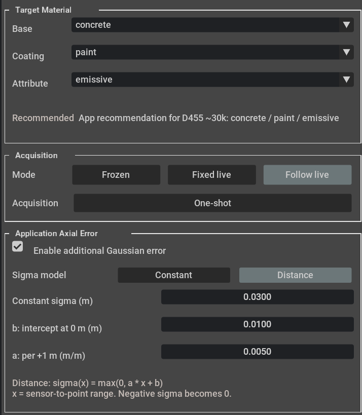

| UI element | Meaning |
|---|---|
| **Target Material > Base / Coating / Attribute** | Changes the non-visual material response assigned to the designed targets for sensor simulation; it does not recolor their OpenGL faces. |
| **Target Material > Recommended** | Shows the app's repeatable comparison preset, not a manufacturer-certified material. Applying a profile may also change the material to that preset. |
| **Acquisition > Frozen / Fixed live / Follow live** | Sets the three sensor pose/update modes described above. Only one is active at a time. |
| **Acquisition > One-shot** | Requests a single scan while continuous acquisition is stopped. |

LiDAR accumulates a complete rotation before publishing a scan, so Apply and
One-shot can include a wait for scan completion. Its angular coverage and
channel count belong to the selected profile; resizing the viewport does not
resize or crop that scan. **Follow live** follows the scanner rig pose, but the
asset's actual measurement origin includes its device mount. **Camera > Use
sensor FOV** matches D455 optics only; it does not turn an OS0 scan into a
camera-shaped field of view.

#### Application Axial Error

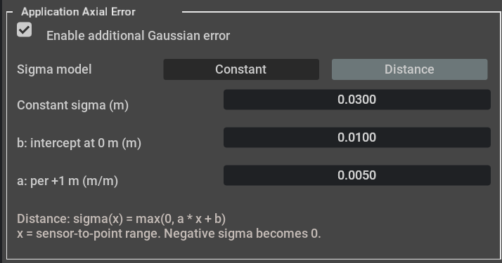

This group is in **Scanner**, not Settings. It adds zero-mean Gaussian
displacement along each sensor-to-point ray after Isaac Sim produces the scan,
for both DepthSensor and LiDAR.
The packaged default enables it in **Distance** mode. The screenshot shows
the current default coefficients and the inactive Constant sigma field.

| UI element | Meaning |
|---|---|
| **Enable additional Gaussian error** | Enables either application error model. Disable it to remove this additional displacement, without disabling Isaac Sim's own processing. |
| **Sigma model > Constant / Distance** | Selects a uniform standard deviation or a range-dependent standard deviation. The distribution remains zero-mean Gaussian and displacement remains along the sensor viewing ray. |
| **Constant sigma (m)** | Population standard deviation in Constant mode, independent of sensor distance. |
| **b: intercept at 0 m (m)** | Zero-range intercept in Distance mode. When non-negative, this is the standard deviation at 0 m. It is not a mean or a position bias. |
| **a: per +1 m (m/m)** | Increase in standard deviation for each additional metre of sensor-to-point range. Default 0.0050 m/m. |

The default model is Distance, with b = 0.0100 m and a = 0.0050 m/m.
Distance mode uses `sigma(x) = max(0, a * x + b)`, where x is the
straight-line distance from the sensor to the point **before** this additional
error is applied, not the point's world-coordinate distance or optical Z depth.
a is non-negative; a negative calculated sigma becomes zero. The a control
accepts 0–0.1 m/m and b accepts −0.1–0.1 m, but the resulting sigma at longer
ranges is not capped at 0.1 m. Inactive controls are grayed out without losing
their values. Model, coefficients and enable state persist between sessions.
Live applies changes to subsequent scans; Frozen requests a fresh scan rather
than changing the held cloud in place. Turning Application Axial Error off
disables both models and leaves Isaac Sim's own sensor processing intact.
Disparity Noise settings apply only to DepthSensor, not LiDAR.

To compare constant and distance-dependent error, select the model, then edit
its active fields. Constant uses **Constant sigma (m)**; Distance uses **b**
and **a**. Both are standard-deviation models, not a systematic position bias.
With the default distance coefficients, sigma is 0.0150 m at 1 m, 0.0200 m at
2 m, and 0.0350 m at 5 m. **b** is the intercept at zero distance.
Previously saved 1 m reference values are converted to zero-range intercepts
by subtracting a, preserving the same distance-dependent error distribution.
Changes take effect without Apply; saved user values override packaged defaults
on later launches. **Reset to Startup** restores this window's launch-time
values. **Settings > Restore Settings Defaults** restores the packaged defaults
for the whole app, including camera and object values, while keeping captures.

### Graphics

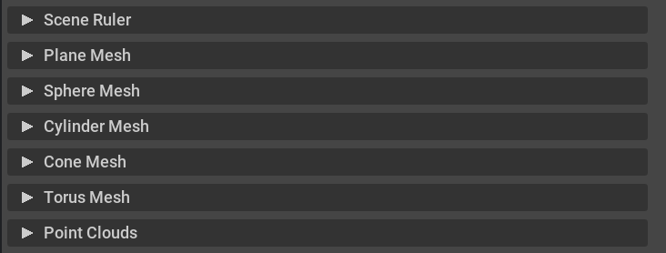

All categories begin collapsed. Graphics changes the *display* of a scan or result, not the measured cloud or the sensor-authoritative object mesh. Open a geometry category to set its three display states independently.

| UI element | Meaning |
|---|---|
| **Plane/Sphere/Cylinder/Cone/Torus Mesh** | Expand one shape's visual settings. Changes here affect that type only. |

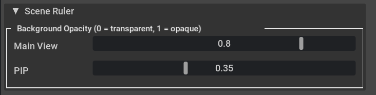

| UI element | Meaning |
|---|---|
| **Scene Ruler > Main View** | Sets the ruler background opacity when the orthographic scene view is primary. Default: 0.80. |
| **Scene Ruler > PIP** | Sets the ruler background opacity independently when the scene view is in PIP. Default: 0.35. |

Both sliders run from 0 (fully transparent background) to 1 (fully opaque).
They leave the ruler's text and tick marks visible. Changes take effect
immediately and are saved between launches.

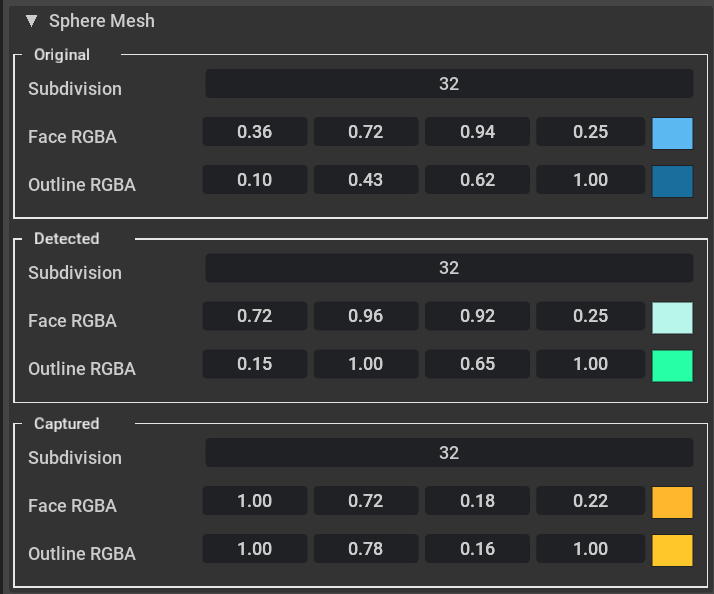

| UI element | Meaning |
|---|---|
| **Original > Subdivision** | Sets the visible original mesh detail. Use Objects > Sensor subdivision to change the mesh actually sampled by the sensor. |
| **Detected > Subdivision** | Sets visible detail of the provisional, pre-capture detected mesh. |
| **Captured > Subdivision** | Sets visible detail of captured meshes of this type, including an existing capture. |
| **Original/Detected/Captured > Face RGBA** | Sets the corresponding mesh face color and transparency. |
| **Original/Detected/Captured > Outline RGBA** | Sets the corresponding mesh wire/outline color and transparency. |
| **RGBA numeric fields / color picker** | Edit red, green, blue, and alpha values numerically or use the picker for RGB; both routes edit the same color state. |

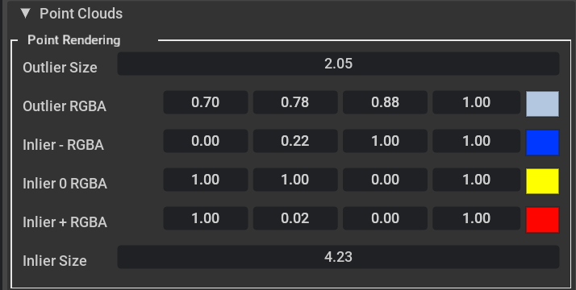

| UI element | Meaning |
|---|---|
| **Point Clouds > Outlier Size / Outlier RGBA** | Controls source/outlier point size and color in the viewport. |
| **Point Clouds > Inlier Size** | Controls preview/capture inlier point size independently of outliers. |
| **Point Clouds > Inlier - / 0 / + RGBA** | Defines the negative, zero/boundary, and positive ends of the signed inlier heatmap palette. Actual point colors are interpolated from each sample's signed residual. |

### Settings

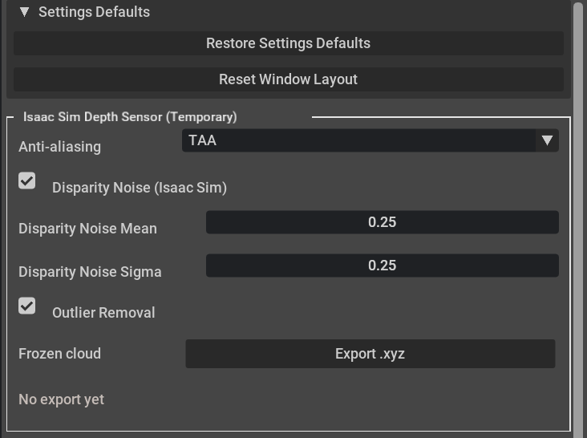

Settings contains global interaction, sensor-render-product diagnostics, and presentation options. The groups marked “Temporary” expose experimental sensor controls.

Window layout is saved between launches. Floating windows may be moved freely
while the app is running. Their saved positions are shifted inward so the entire
window fits inside the application content area. Saved floating windows have a
minimum size of 320 × 240 UI points, or the available content size if smaller;
oversized windows are reduced to fit. The same checks run on restore using the
current content size. If layout initialization or docking fails, the app attempts
to restore the packaged default docking layout. **Reset Window Layout** restores
that default arrangement manually.

The **Isaac Sim Depth Sensor** group, including anti-aliasing, Disparity Noise,
its Mean/Sigma and Outlier Removal, configures DepthSensor only. These controls
do not add LiDAR noise. Use **Scanner > Application Axial Error** for the
additional error model shared by both sensor families.

| UI element | Meaning |
|---|---|
| **Settings Defaults > Restore Settings Defaults** | Restores packaged defaults for camera, objects, sensor, FindSurface, and settings while keeping captured geometries. This differs from launch-time Reset to Startup. Undo is available. |
| **Settings Defaults > Reset Window Layout** | Restores the original dock positions, property tab order, and docked window sizes; clears the saved window layout for future launches. It does not change camera, object, sensor, or captured-geometry data. |
| **Isaac Sim Depth Sensor (Temporary) > Anti-aliasing** | Selects a render-product anti-aliasing mode to compare how it affects the depth-derived cloud. |
| **Disparity Noise (Isaac Sim)** | Enables Isaac Sim's disparity-space sensor noise for subsequent live or one-shot scans. |
| **Disparity Noise Mean / Sigma** | Pixel-valued `noiseMean` and `noiseSigma` parameters passed to Isaac Sim. They are not direct metre-valued surface-error controls; compare scans to assess their effect. |
| **Outlier Removal** | Enables or disables the DepthSensor's outlier-removal processing for subsequent scans. |
| **Frozen cloud > Export .xyz** | Writes the currently frozen cloud as text lines of `x y z` in metres. Disabled until a suitable frozen cloud exists; the row below reports the outcome. |

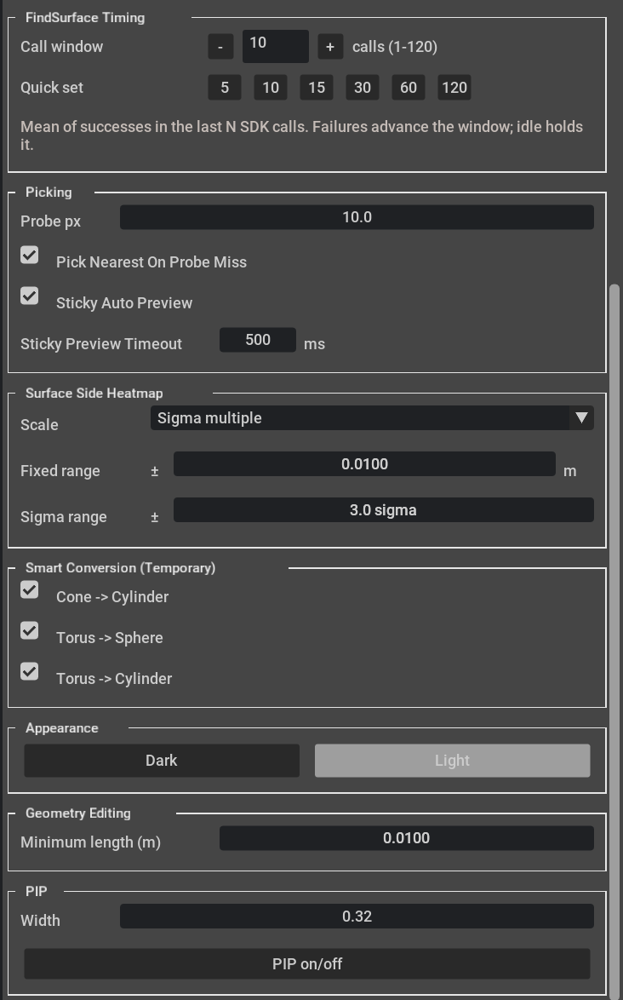

| UI element | Meaning |
|---|---|
| **Picking > Probe px** | Screen-space radius used to seek a point near the cursor before detection. |
| **Pick Nearest On Probe Miss** | Allows the nearest eligible point to be chosen when the probe contains no point. |
| **Sticky Auto Preview** | Temporarily retains a successful hover preview after a later failed request. It does not make an old result capturable. |
| **Sticky Preview Timeout** | Duration of that retained display, in milliseconds. |
| **Surface Side Heatmap > Scale** | Selects Auto (full range), Fixed distance, or Sigma multiple for mapping signed surface-side distance to colors. The default for both DepthSensor and LiDAR is Sigma with multiplier 3. |
| **Surface Side Heatmap > Fixed range / Sigma range** | Sets the `±` distance in metres or the `±` standard-deviation multiplier for the selected scale mode. Neither changes the measured residuals. |
| **Smart Conversion (Temporary) > Cone → Cylinder / Torus → Sphere / Torus → Cylinder** | Separately enables the three conditional FindSurface result conversions for diagnostic comparison. A checked option does not force every result to convert. |
| **Appearance > Dark / Light** | Switches the application UI theme. |
| **Geometry Editing > Minimum length (m)** | Lower bound applied when a metre-valued Objects dimension is next edited; raising it does not immediately rewrite existing dimensions. |
| **PIP > Width / PIP on/off** | Sets the picture-in-picture width fraction or hides/shows the secondary view. It does not switch which view is primary; use `P` for that. |

Most controls take effect immediately. Saved user preferences are restored on a later launch, but sensor mode starts from the packaged default for safety. User edits support Undo/Redo; continuously acquired scans are not stored in the edit history.

#### FindSurface call time

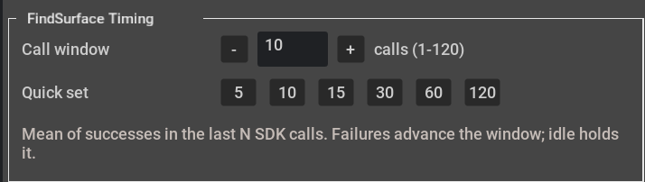

**Settings > FindSurface Timing** controls the **FindSurface ms** value in the
upper-left viewport overlay. It appears before Picking; the screenshot shows
the default 10-call window and all six quick presets.

| UI element | Meaning |
|---|---|
| **Call window** | Number of recent actual SDK calls retained for the mean: 1–120, default 10. Edit the integer directly or use the stepper buttons. |
| **- / +** | Decreases or increases the window by one, stopping at 1 and 120. |
| **Quick set: 5 / 10 / 15 / 30 / 60 / 120** | Changes the same window immediately to the selected size. |

Every completed SDK `find()` call occupies one position in the window,
including failures. Only successful calls contribute time to the sum and
count to the denominator. For a five-call window containing success 12 ms,
failure, success 18 ms, failure and success 30 ms, the display is
`(12 + 18 + 30) / 3 = 20 ms`, not a division by five. If the next call fails,
the 12 ms success leaves the window and the mean becomes 24 ms.

At size 1, a success shows that call's duration and a failure shows `-- ms`.
Any window without a success shows `-- ms`. With no actual SDK calls—for
example, after leaving the viewport—the window and display remain unchanged.
Busy-skipped requests and requests rejected before SDK invocation do not
advance the window. A successful call counts even if its result is no longer
current enough to display.

This is **execution time**, not throughput or FPS: cloud preparation, native
parameter setup, result conversion, histograms, heatmaps and idle time are
excluded. Changing the window recomputes the mean from the retained recent
calls (up to 120); it does not trigger detection. The window size is saved and
supports Undo/Redo and reset; measured call history is not saved and starts
empty in a new session.

### Comparing sensor results

1. Keep the original objects and scanner rig pose fixed. Select a sensor in
   **Scanner > Point Cloud Sensor**, then press **Apply** and wait for a scan.
2. Use **Frozen** and **One-shot** to collect separate completed scans. Match
   Application Axial Error settings between profiles; disable it in a separate
   pass if you want to inspect native sensor output. Disparity controls remain
   DepthSensor-specific.
3. Select a point on the corresponding part of the same object and use the
   same FindSurface type and parameters. Capture each successful result and
   inspect the three graphs in **Geometries**. A new capture of a type replaces
   its previous capture, so save screenshots or notes before replacing it.
4. Compare **Original Residual** for point-to-original departures and
   **Surface Side Distance / Match RMS** for recovered-surface disagreement.
   A small Fit RMS alone does not guarantee a close match to the original.
5. The default **Sigma, 3 sigma** colors each result from -3 sigma (blue) through
   zero (yellow) to +3 sigma (red). Sigma is each result's own population
   standard deviation, so matching colors indicate matching relative distances,
   rather than matching metre distances. For an absolute-distance color
   comparison, optionally choose the same **Fixed** metre range in Settings.
   Hovering each histogram temporarily switches its heatmap basis. Read sample
   counts and proportions rather than comparing raw bar counts between clouds.

Sensor assets have different measurement origins, sampling patterns and visible
surface coverage, even with the same rig pose. Repeat scans and record the
profile, rig pose, error controls, FindSurface parameters and successful/failed
attempts. See the README's [sensor comparison](README.md#depthsensor-and-lidar-side-by-side)
for measured examples and their limits.

## Navigate the views

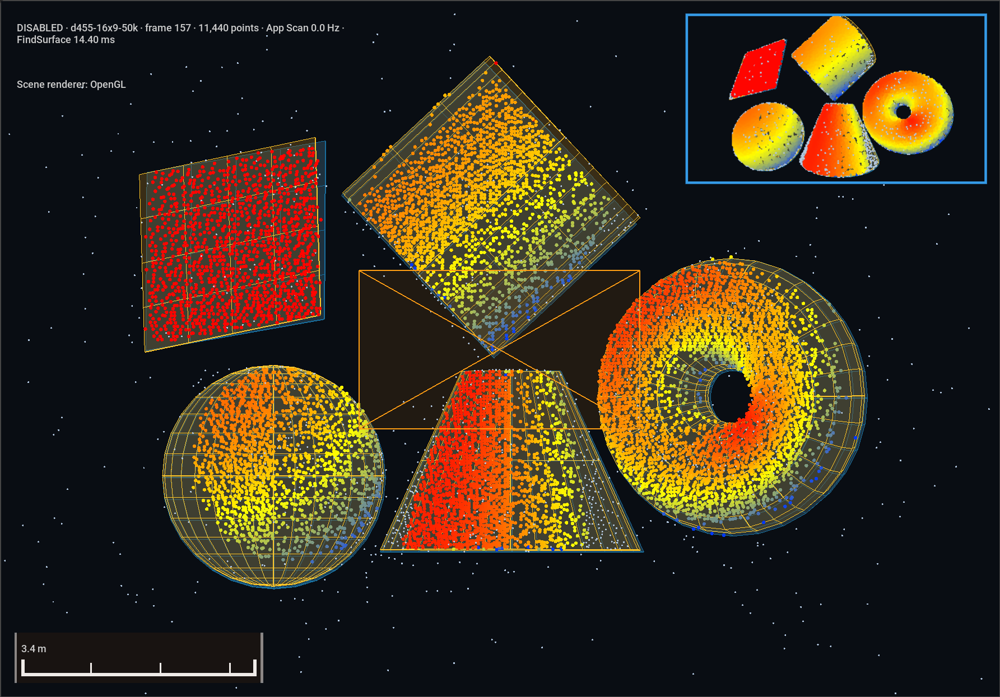

Use right-drag in the scanner view to look around. The scanner supports `W/A/S/D` or arrow keys for movement and `Q/E` and `Z/C` for vertical/roll control. The scene view supports its own orbit/roll gestures, keyboard navigation, and wheel zoom. Hold `Ctrl` for finer keyboard movement or `Shift` for faster movement. The **Camera** window provides numeric controls and individual resets when exact positioning is easier. The active main view receives viewport input; `P` swaps scanner and scene priority. `R` resets the camera of the active main view.

In Orthographic mode, the scene view's movable ruler shows the full interval
between its two end marks, whether the scene is in the main viewport or PIP.
The unit is always metres, consistent with the scene and geometry information.
The label uses one decimal place, adding a superscript power of ten when its
exponent is nonzero: for example, 4.5 m or 4.5 × 10-3 m.
Major tick spacing follows that power of ten. When the gap between major ticks
reaches 100 logical screen pixels, shorter half-interval ticks appear; at
200 pixels, the smallest tenth-interval ticks also appear. For a 1.3 m ruler,
these represent 1 m, 0.5 m and 0.1 m intervals respectively. Zooming or resizing
updates their density automatically. The three tick lengths distinguish these
levels (16, 12 and 8 logical pixels long). Major ticks are 2 pixels thick and
the other ticks are 1 pixel thick. The 20-pixel end marks and the baseline are
4 pixels thick in the main view, clearly bounding the measured
interval, including any fractional remainder at the right end.
When the scene view is primary, drag inside the ruler to move it, or drag the
handle at either end to shorten or extend it horizontally. Resizing keeps the
opposite end fixed and updates the metre label without changing the camera's
zoom or projection. The image above shows an extended ruler.

PIP uses a shorter, fixed-length ruler, independently
of the main ruler's chosen length. Its marks are also more compact: tick
lengths are 12, 9 and 6 logical pixels, with 15-pixel end marks and a 3-pixel
boundary/baseline thickness. Thin ticks remain at least 1 pixel thick for
readability. The main-view dimensions are unchanged when swapping views.
Adjust its background under
**Graphics > Scene Ruler > PIP** to keep the scene visible through the panel.

### Controls & Help

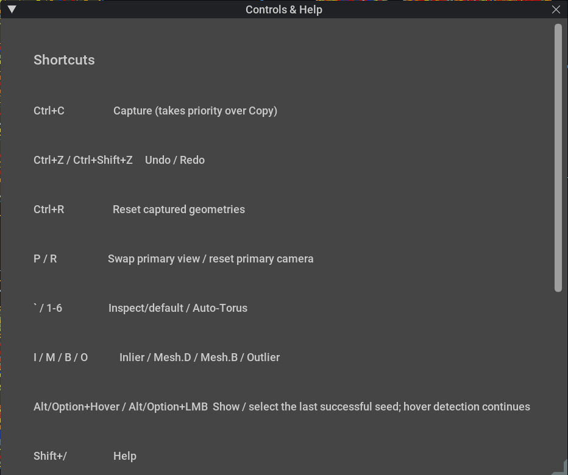

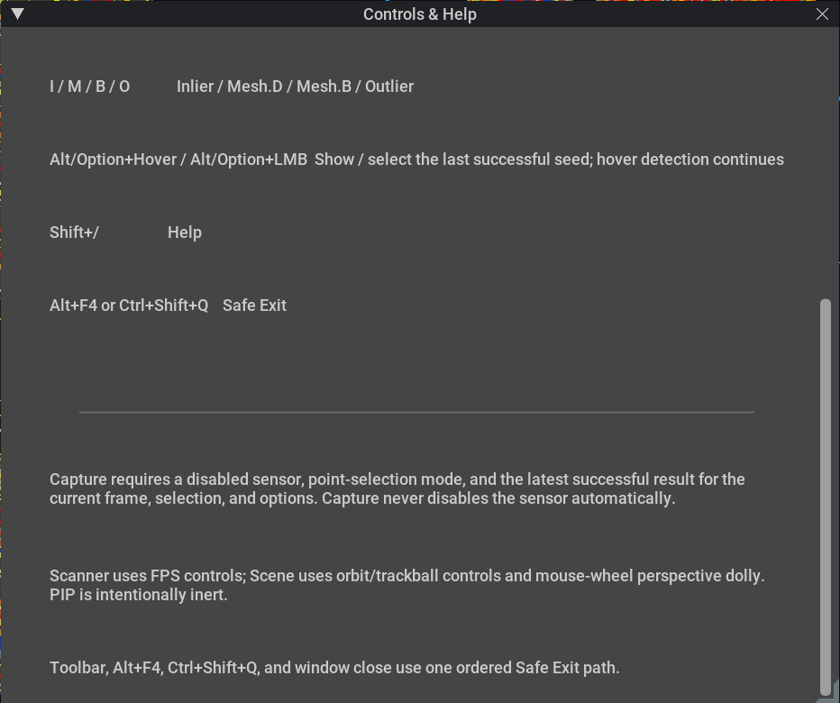

The toolbar **Help** button opens a scrollable shortcut and workflow reference.
These two images show its upper and lower sections.

## Troubleshooting

- **No points:** Check that the target is inside the selected sensor profile's range and angular coverage. In Frozen mode, request a one-shot scan or switch to a live mode. LiDAR waits for an accumulated complete scan; a viewport edge is not its coverage boundary. An empty scan may be valid when nothing is in range or produces a usable return; for LiDAR also check Target Material.
- **No detection:** Confirm that **Inspect** is off, the cursor is near a point, and the chosen type matches the target. Try Frozen mode so a stable cloud remains under the cursor; adjust probe and FindSurface settings as needed.
- **Capture disabled:** Use Frozen mode, select a point, and wait for a successful result matching the current cloud, selection, and parameters. A visible Sticky result alone is insufficient.
- **Cloud does not match a recently edited object:** Wait for the follow-up scan after the edit, or request a one-shot scan in Frozen mode. Do not infer completion from the visual mesh alone.
- **DLL load or version problem:** Consult [native SDK setup](NATIVE_SDK.md). The repository does not contain the SDK DLL; use the approved release and verify the configured checksum.
- **GPU or startup failure:** Isaac Sim's runtime, DepthSensor and RTX LiDAR have hardware and driver requirements. Run `repo.bat doctor` (Windows) or `bash repo.sh doctor` (Ubuntu) and consult Isaac Sim's supported-system documentation. OpenGL view rendering does not remove the sensors' RTX runtime requirement.

Use **Safe Exit** to close the app through its normal cleanup path. For reproducible reports, include the sensor profile, point count, mode, FindSurface type/parameters, app log, and exact steps.
