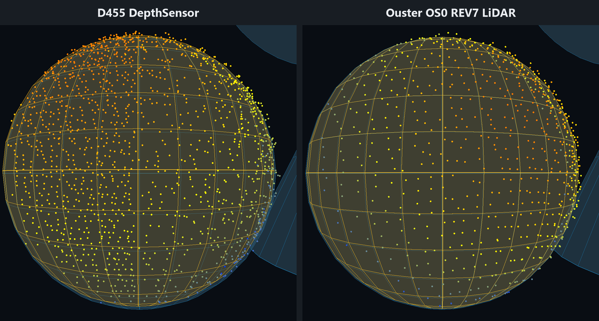
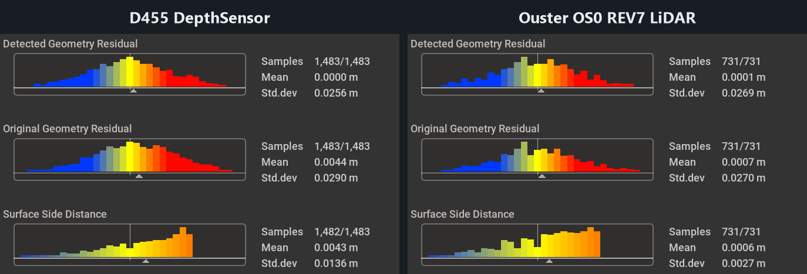
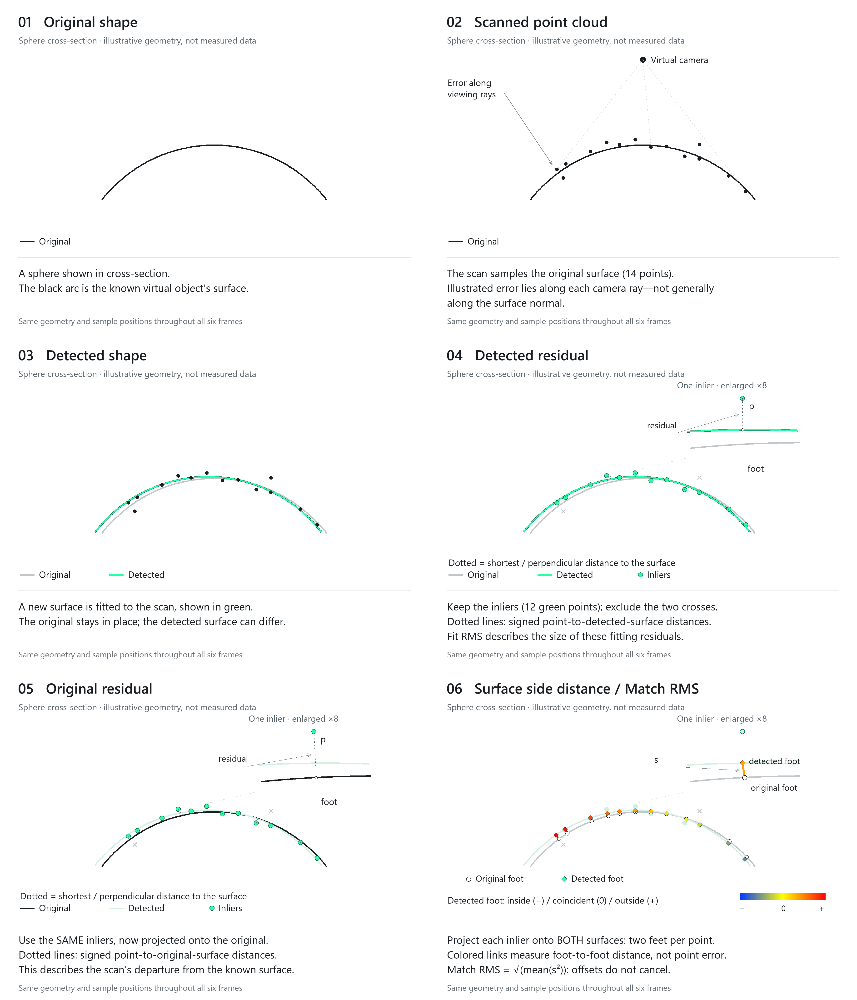

# FindSurface Isaac Sim Demo

**Curv*Surf* FindSurface™** demo application for NVIDIA Isaac Sim 6.0.1.

Isaac Sim can generate point clouds from a virtual scene. How much of the
scene's geometry can we recover from those scans—and what changes when we
switch the simulated sensor?

This demo uses **FindSurface** to turn scans from a D455-style DepthSensor or
Ouster OS0 LiDAR into planes, spheres, cylinders, cones and tori. Because the
original objects are known, we can overlay each recovered surface on its
reference and examine their agreement. FindSurface supplies the geometric
interpretation that makes those differences measurable: a scan becomes a
surface with a type, position, orientation and dimensions.

See what it looks like in action in the video below.

Click the thumbnail above or [here](https://www.youtube.com/watch?v=bgYpIVXgH0U) to watch the video on YouTube.

## What the experiment reveals

We scanned the same scene repeatedly with DepthSensor and LiDAR at two scanner
positions, then compared the detected geometry with the original objects.
With application-added error disabled, DepthSensor's sphere points fitted a
sphere very tightly, while the recovered sphere was displaced relative to the
original. OS0's points had more spread around their fitted sphere, yet that
sphere agreed more closely with the reference. With the shared distance-based
error enabled, point spread increased and this ordering of recovered-sphere
agreement remained in both tested positions.

FindSurface exposes both aspects of the scan: **how well its points fit a
surface, and how closely that recovered surface matches the original**.
Together, the overlays, heatmaps and histograms make these differences visible.

Of course, the comparison reflects the complete simulation setup, including
sensor mounts, sampling, mesh detail, added error and fitting parameters.
Even so, it adds a useful known-reference experiment alongside FindSurface's
[Omniverse point-cloud demo](https://github.com/CurvSurf/FindSurfaceOmniverseDemo),
[iOS LiDAR demo](https://github.com/CurvSurf/FindSurface-GUIDemo-iOS) and
[iOS feature-point demo](https://github.com/CurvSurf/ARFeaturePointFindSurface).
Those examples show FindSurface working with other point-cloud sources; this
demo lets you inspect its recovered geometry against the scene that produced
the scan.

## DepthSensor and LiDAR, side by side

Both examples below use the same object layout, scanner-rig pose, target
material, FindSurface parameters and application-added Distance error. Each
column shows one captured sphere, with the same close-up camera and the default
Surface Side **3-sigma** color rule. Each result uses its own standard deviation
to set its color endpoints. Click an image to inspect it at full resolution.
The screenshots retain native render resolution. Within each comparison image,
both sensor panels have identical crop dimensions and display magnification.
The sensor names identify the left and right panels.

Individual originals: D455 [heatmap](docs/images/comparison/depth-surface-side.png)
and [histograms](docs/images/comparison/depth-histograms.png);
OS0 REV7 [heatmap](docs/images/comparison/lidar-surface-side.png)
and [histograms](docs/images/comparison/lidar-histograms.png).

In the DepthSensor results, the sphere's left and right sides showed outward
and inward surface differences in every repeat, both with and without the
application-added error. OS0 occasionally showed that sign split, but it did
not repeat consistently across the tested profiles and positions. Here, left
and right refer to the sides of each object as seen from the scanner camera.

The histograms provide a complementary view. **Detected Residual** describes
the spread around the recovered surface; **Original Residual** describes the
same points relative to the reference. **Surface Side Distance** describes
how the recovered surface differs from that reference at the sampled locations.
Read the distribution's position and width alongside the spatial color pattern.

The DepthSensor optical pose was verified against the requested scanner pose
for every measured scan. OS0 retains its asset's small mount offset and angular
sampling pattern, so the comparison characterizes the configured pipelines.
The [comparison report](docs/SENSOR_COMPARISON.md)
contains the conditions, repeated measurements, detection failures and analysis
limits, including OS0 REV6 results. It also records how these fresh illustrative
captures were selected and relates them to the repeated measurements.

## Reading agreement with the original

*Illustrative cross-section. Click to follow all six panels individually.*

For each captured inlier, imagine dropping a perpendicular to the detected
surface and another to the original surface. The two landing points are its
nearest surface points, or **projection feet**.

| View | How to read it |
|---|---|
| **Detected Geometry Residual** | Distance from each scan point to its foot on the detected surface. It describes the fit to the measured points. |
| **Original Geometry Residual** | Distance from the same scan point to its foot on the original surface. It describes the scan's departure from the reference. |
| **Surface Side Distance** | Distance between those two feet, signed by whether the detected foot lies inside or outside the original surface. It describes the recovered geometry's local difference from the reference. |

In the signed heatmaps, blue marks negative distances, yellow values near zero,
and orange/red positive distances. On closed objects these correspond to inside,
near coincidence and outside. The histogram collects those signed distances into
bins; its mean indicates their net bias and its standard deviation indicates
their spread around that mean. Opposite-sign differences can cancel in the mean.

**Fit RMS** is FindSurface's summary of the point-to-detected-surface error.
**Match RMS** summarizes the foot-to-foot distances: square each distance,
average the squares, then take the square root. This keeps both an overall
offset and spatially varying disagreement in the result. Read these summaries
together with the colors and distributions to see how the recovered geometry
differs from the original.

The default for both sensor families is **Sigma, 3 sigma**: blue is reached at
minus three standard deviations, yellow at zero, and red at plus three standard
deviations, all measured from zero distance. Thus the colors show relative
variation within each result; the same color can represent different metre
distances in the two columns. The report explains the
[calculations and histogram filtering](docs/SENSOR_COMPARISON.md#distance-measures-and-histogram-statistics)
and provides the absolute distances. A common Fixed range is also available
when you want colors to represent the same metre distances across results.

## How the scans are produced

The D455-style DepthSensor uses a single rendered camera view with disparity
reprojection, noise and filtering to simulate stereoscopic depth. Ouster OS0
REV6/REV7 use 128-channel rotary LiDAR profiles and publish accumulated
360-degree scans. Their image-based and angular sampling give different point
distributions and surface coverage. NVIDIA describes the
[DepthSensor pipeline](https://docs.isaacsim.omniverse.nvidia.com/6.0.1/sensors/isaacsim_sensors_camera_depth.html)
and [RTX LiDAR pipeline](https://docs.isaacsim.omniverse.nvidia.com/6.0.1/sensors/isaacsim_sensors_rtx_lidar.html).

In this scene, native DepthSensor points were exceptionally clean around
their fitted surfaces. [FindSurface](https://github.com/CurvSurf/FindSurface#overview)
is designed for measured point clouds with measurement error and recommends
controlled Gaussian error for testing nearly error-free synthetic data.
The demo therefore provides **Application Axial Error**: a configurable,
zero-mean Gaussian displacement along each sensor-to-point ray. It is applied
after either sensor produces its points, and the resulting cloud is shared
by display, picking and detection. Its surface-normal component depends on
the viewing angle.

The default Distance model increases the error's standard deviation with
sensor range. You can change it, select Constant error, or disable it to
inspect the native output. DepthSensor also has its own disparity-processing
controls. See the [Scanner manual](MANUAL.md#application-axial-error) for the
settings and the report for the parameters used in the experiment.

## Explore the demo

1. In **Follow live**, hover over the five objects and watch FindSurface
   recover their geometry. Choose Auto or a specific geometry type.
2. Switch to **Frozen**, select a point and **Capture** a successful result.
3. In **Geometries**, inspect the recovered and original parameters, switch
   heatmap basis, and hover over the three histograms.
4. Change the sensor or error settings and compare another scan.

The main viewport starts with a first-person scanner-camera view, with a
third-person scene overview in PIP. A toolbar button swaps the two views.
Both display views use OpenGL; point generation uses Isaac Sim's internal
RTX sensor pipeline.

FindSurface derives geometric types, poses and dimensions mathematically,
independently of a trained point-cloud dataset. The sample code shows how to
connect simulated sensor scans to that detection path—for example, in a
virtual robot or drone that recovers geometry while scanning its surroundings.
The experiment also makes unusually clean simulation input and its effect on
geometry recovery visible, helping you explore the measurement conditions
your own workflow will encounter.

## Run the demo

Use **`Start_Demo.bat`** on Windows or **`bash Start_Demo.sh`** on Ubuntu x86_64,
from a recursive clone or an assembled release package.
It reuses compatible dependencies, prepares missing ones and launches the app.
Isaac Sim 6.0.1, a compatible NVIDIA GPU/driver and the separately supplied
FindSurface SDK are required.

Ubuntu setup also builds the native point picker when it is not already packaged.
See the installation guide for prerequisites and platform verification status.

- [Installation, source checkout and removal](INSTALL.md)
- [FindSurface SDK setup](NATIVE_SDK.md)
- [User manual](MANUAL.md)
- [Repeated sensor comparison and data](docs/SENSOR_COMPARISON.md)

## Licensing and distribution

The CurvSurf-owned application code and documentation are available under the
[MIT License](LICENSE).

**The native FindSurface SDK binaries, including `FindSurface.dll` and
`libFindSurface.so`, are not covered by this MIT license.** They are obtained
separately and remain subject to CurvSurf's SDK terms and any applicable
commercial agreement, including when downloaded by the launch scripts.

The FindSurfaceOmniverseExtension submodule, NVIDIA Isaac Sim/Kit and other
third-party components retain their own applicable terms.
Preserve the bootstrap extension's
[third-party notices](source/extensions/com.findsurface.bootstrap/THIRD_PARTY_NOTICES.md)
and the application's [third-party notices](THIRD_PARTY_NOTICES.md).
