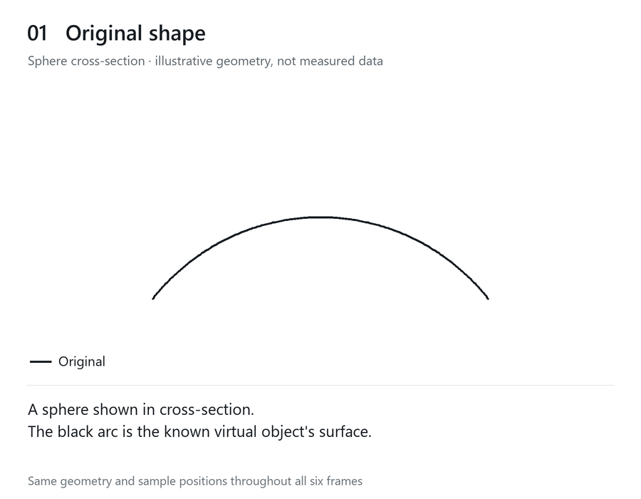
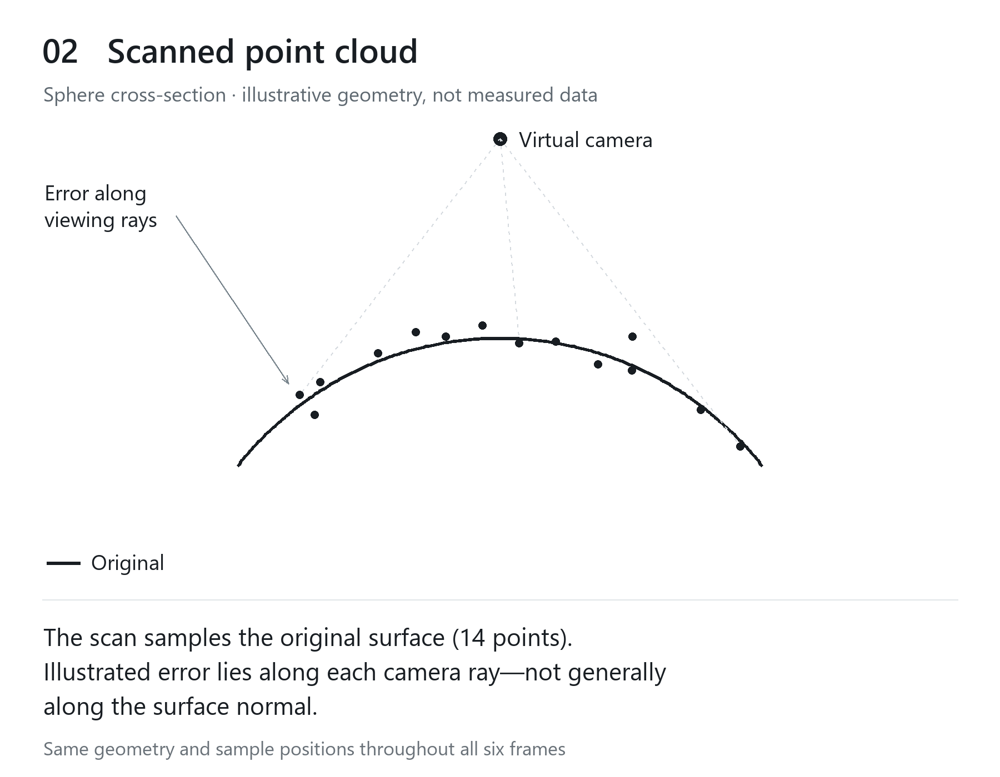
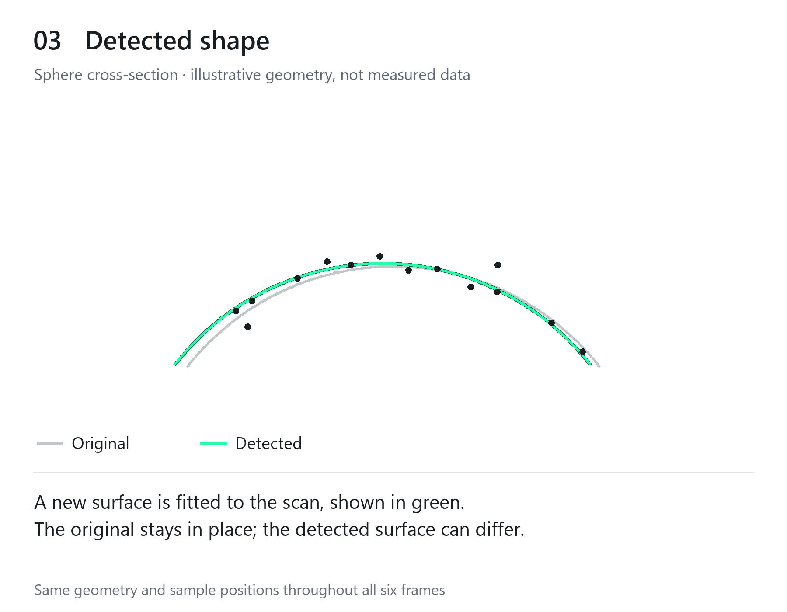
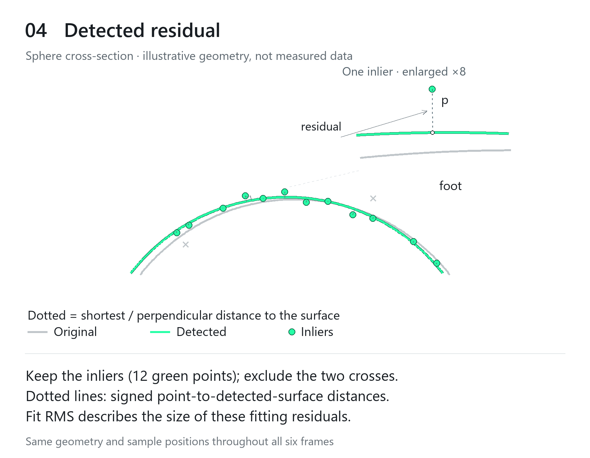
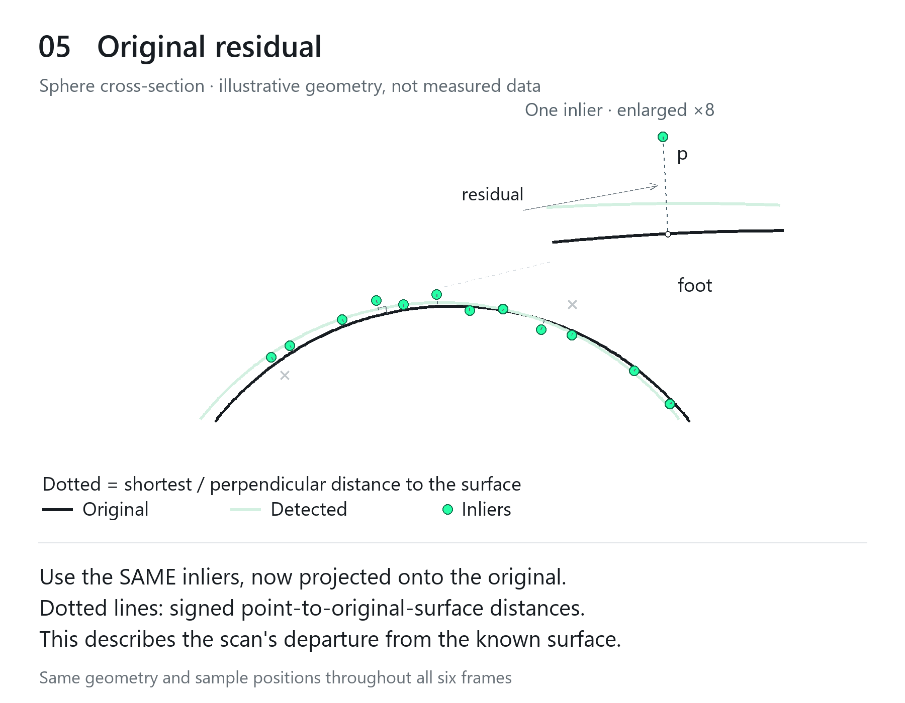
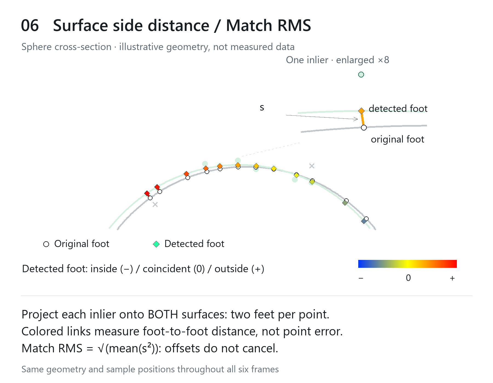

# Reading agreement with the original — step by step

[Back to the README](../README.md#reading-agreement-with-the-original)

The same geometry and scan points continue through all six panels below. Each
image fills the document's content width; scroll down to follow the construction.
This is illustrative geometry, not measured Isaac Sim data or an actual
FindSurface result. The enlarged details follow the same inlier in every panel.

Watch the construction as an animation

## 1. Original shape

## 2. Scanned point cloud

## 3. Detected shape

## 4. Detected residual

## 5. Original residual

## 6. Surface side distance and Match RMS

[Back to the README](../README.md#reading-agreement-with-the-original)
